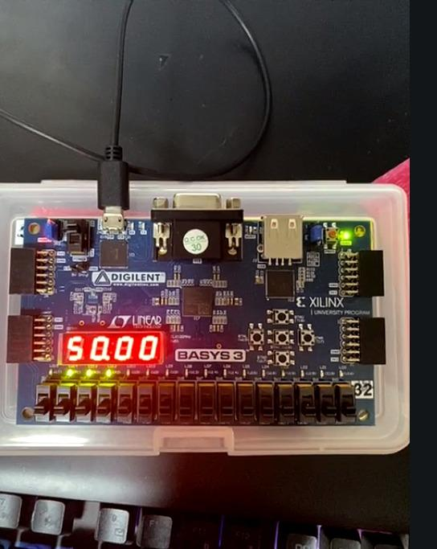
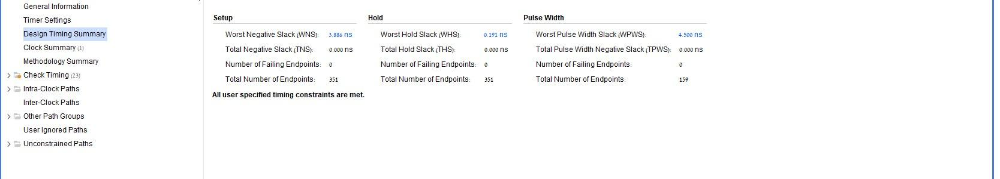
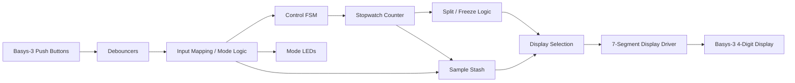
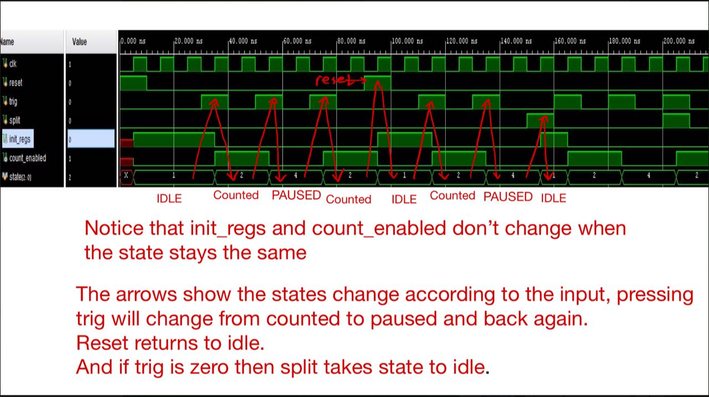
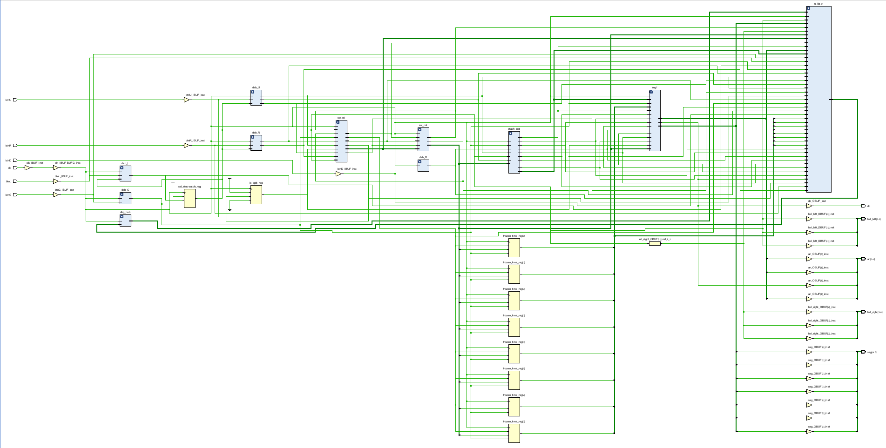
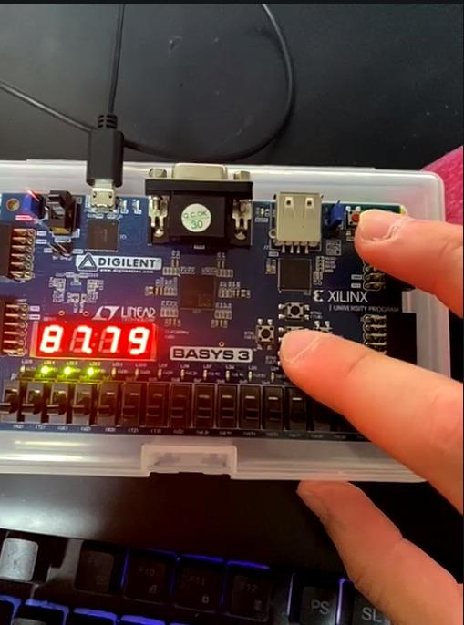
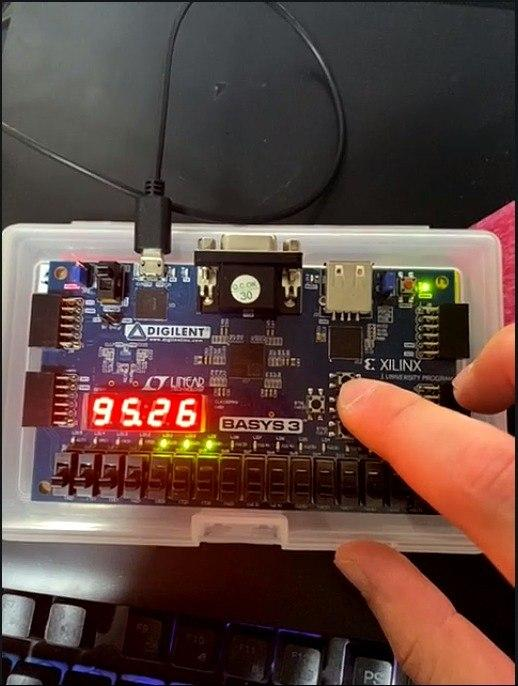
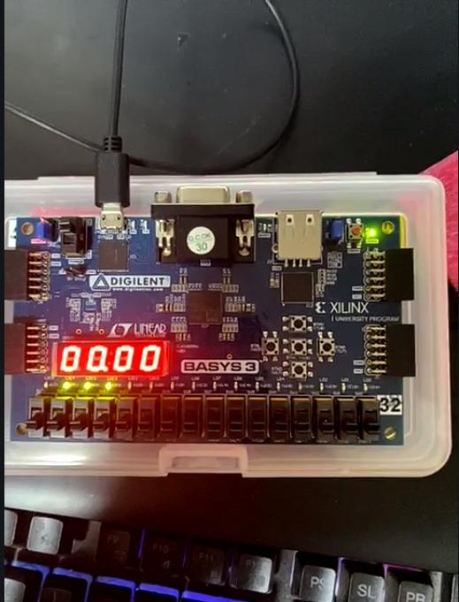

# FPGA Stopwatch - Verilog on Basys-3

A modular stopwatch system implemented in **Verilog** on a **Digilent Basys-3 / Xilinx Artix-7 FPGA** using **AMD/Xilinx Vivado**.

The design was completed as a two-person university laboratory project and taken through the full FPGA workflow: RTL design, module-level simulation, waveform debugging, synthesis, XDC constraints, implementation, timing analysis, bitstream generation, JTAG programming, and physical-board validation.

<p align="center">
  
</p>

## Highlights

- Modular Verilog RTL with parameterized reusable building blocks
- FSM-based stopwatch control with **IDLE, COUNTING, and PAUSED** behavior
- Hierarchical counter and clock-division logic driven from the board clock
- Digital push-button debouncing and one-cycle pulse generation
- Sample storage ("stash") for captured stopwatch readings
- Split/freeze functionality and selectable stopwatch/stash display modes
- Multiplexed four-digit seven-segment display interface
- RTL testbenches, behavioral simulation, and waveform-based debugging in Vivado
- XDC clock and I/O constraints for the Basys-3 board
- Post-implementation timing closure and physical hardware validation

## Implementation Results

The implemented design met the specified timing constraints:

| Metric | Result |
|---|---:|
| Worst setup slack (WNS) | **+3.886 ns** |
| Worst hold slack (WHS) | **+0.191 ns** |
| Failing setup endpoints | **0** |
| Failing hold endpoints | **0** |
| Longest reported setup path | **8.181 ns** |

<p align="center">
  
</p>

## Architecture



The RTL was built from smaller reusable modules including a full adder, parameterized conditional-sum adder, limited incrementer, counter, control FSM, debouncer, sample stash, and top-level stopwatch integration.

More detail is available in [`docs/architecture.md`](docs/architecture.md).

## Verification and Debugging

The project used module-level RTL testbenches and Vivado behavioral simulation to verify arithmetic, counter, storage, and control behavior before hardware integration. Waveform analysis was used to debug state transitions and timing behavior.

<p align="center">
  
</p>

See [`docs/verification.md`](docs/verification.md) for the verification flow.

## FPGA Implementation

After RTL verification, the complete top-level system was:

1. Elaborated and checked in Vivado
2. Synthesized to FPGA primitives
3. Constrained using an XDC file for the board clock and I/O
4. Implemented and routed
5. Checked for setup/hold timing closure
6. Converted into a bitstream
7. Programmed onto the Basys-3 over JTAG
8. Tested using the physical buttons, LEDs, and seven-segment display

<p align="center">
  
</p>

## Hardware Validation

Physical-board tests included normal stopwatch operation, storing a sampled reading, counter wraparound, navigating stored samples, split/freeze behavior, and reset back to the default stopwatch state.

<table>
<tr>
<td><br><b>Stopwatch running</b></td>
<td><br><b>Hardware interaction / sample test</b></td>
</tr>
<tr>
<td><br><b>Stored-sample navigation</b></td>
<td><br><b>Reset/default state</b></td>
</tr>
</table>

## Repository Structure

```text
fpga-stopwatch/
├── README.md
├── docs/
│   ├── architecture.md
│   ├── verification.md
│   └── results.md
├── media/
│   ├── hardware/
│   └── vivado/
├── source/
│   └── README.md
└── .gitignore
```

## Source-Code Note

The complete Verilog source is intentionally **not published in this public portfolio repository** because the project originated from university laboratory coursework. This repository focuses on the architecture, verification methodology, FPGA implementation flow, timing results, and physical hardware demonstration.

## Tools and Technologies

**Verilog · AMD/Xilinx Vivado · Basys-3 · Xilinx Artix-7 · RTL Simulation · XDC · STA · FPGA Implementation · JTAG Programming**
