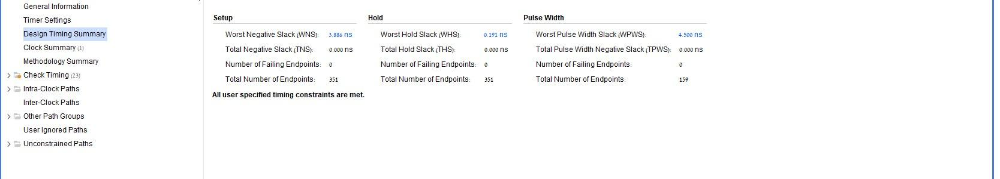
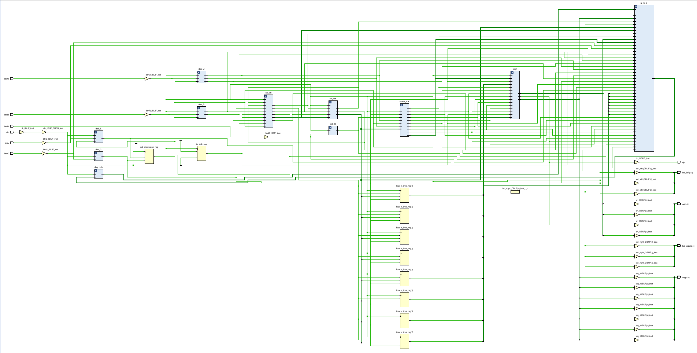
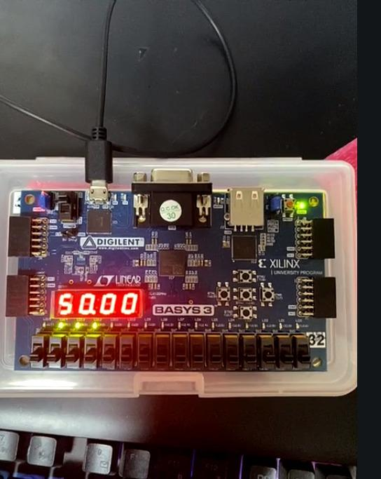
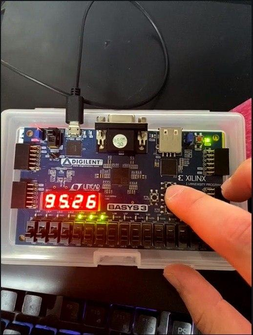

# Results

## Timing Closure

The final implemented design reported positive setup and hold margins:

| Timing metric | Result |
|---|---:|
| Worst setup slack (WNS) | **+3.886 ns** |
| Worst hold slack (WHS) | **+0.191 ns** |
| Setup failing endpoints | **0** |
| Hold failing endpoints | **0** |
| Longest reported setup path | **8.181 ns** |

## Synthesized Design

The synthesized design contains the integrated top-level logic, debounced input paths, counter/control logic, storage, display logic, and physical I/O interfaces.

## Physical Validation

The completed bitstream was programmed onto the Basys-3 board and exercised through its push buttons, LEDs, and seven-segment display.

Documented hardware checks included:

- stopwatch operation on the physical FPGA;
- sampling a stopwatch value into the stash;
- wraparound behavior;
- browsing multiple stored samples;
- reset returning the design to the stopwatch/default state.

### Board Photos

