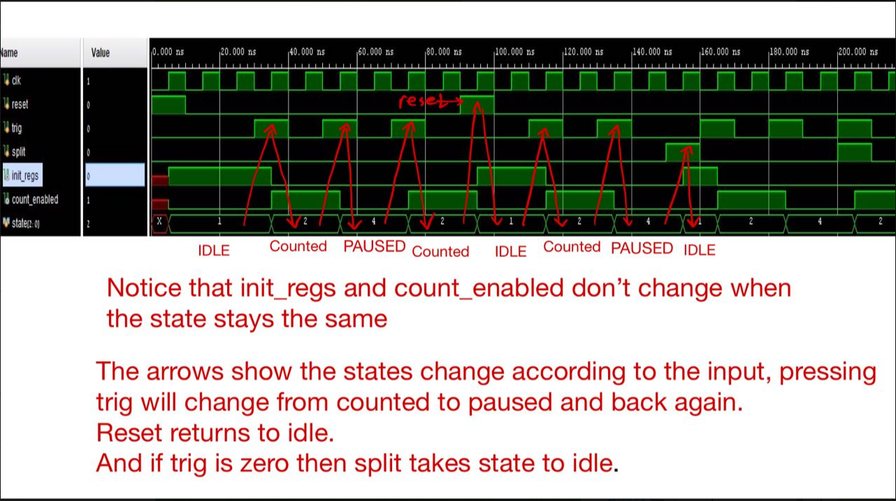

# Verification and Debugging

## RTL Verification

The project was verified incrementally. Smaller modules were simulated before being integrated into the complete stopwatch.

The laboratory flow included testbench-based verification for modules such as:

- full adder;
- parameterized conditional-sum adder;
- limited incrementer;
- stopwatch counter;
- sample stash;
- control FSM.

Simulation waveforms were inspected in Vivado to verify expected outputs, state transitions, carry/wrap behavior, storage behavior, and control sequencing.

## Control-FSM Debugging

The control testbench exercised transitions between IDLE, COUNTING, and PAUSED and checked the corresponding initialization and count-enable outputs.

## Integration Flow

After module-level simulation:

1. The stopwatch top level was elaborated in Vivado.
2. The elaborated hierarchy was checked for missing or incorrect connections.
3. The design was synthesized.
4. Critical warnings and implementation errors were resolved.
5. Clock and I/O constraints were applied using XDC.
6. Implementation was run and the timing summary was checked.
7. A bitstream was generated and programmed onto the FPGA over JTAG.
8. Physical inputs and display behavior were exercised on the Basys-3 board.

## Hardware Tests

Board-level testing demonstrated:

- normal stopwatch counting;
- pause/resume operation;
- split/freeze behavior;
- sampling stopwatch values into the stash;
- navigation through stored samples;
- counter wraparound;
- reset back to the default stopwatch state.
